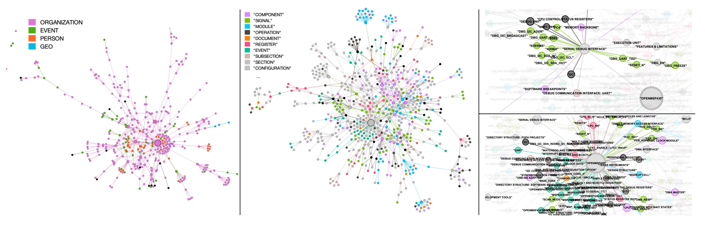

# AssertionForge

## REGuard 最新研究更新（2026-11-04）

已加入 research192–199 的主动时序证据选择、定位与局部修改、组件触发保护、自动回退和在线对照代码。结果、版本范围及复现限制见 [研究更新说明](docs/reguard_research/README.md)，最新正反案例见 [案例卡](docs/reguard_research/research199/cards.html)。研究结果包含无收益和失败情况；实验完成不等于断言全部通过验收。

本次更新的离线检查：`python -B scripts/check_reguard_release.py`。完整历史续跑需要未随仓库发布的原始归档。原有 `LOCAL_COPY_REPORT.md` 和 `COPY_MANIFEST.sha256` 描述上次整理，本次增量见 [发布清单](docs/reguard_research/manifest.json)。


## 本地整理副本：安装与运行

此副本保留当前源代码和基准输入，不包含 Git 历史、安装环境、模型权重或完整历史实验目录。下文原始说明及 `docs/` 中的历史结果是原项目记录，**不是本次整理重新验证的结果**。整理范围及本次验证见 [LOCAL_COPY_REPORT.md](LOCAL_COPY_REPORT.md)。

### 环境与安装

- 主项目是 Python 研究原型；RTL 仿真/形式验证流程主要面向 Linux/WSL。建议用 Python 3.10 的独立环境尝试原始主流程；本次静态及离线验证使用 Python 3.13，未重新安装整个依赖集合。
- 根目录的四份 `requirements*.txt` 均保留。`requirements.txt` 是较大的历史环境清单，含 Linux 专用依赖及部分未固定版本，不能视为已验证的跨平台锁文件；原项目没有根级依赖锁文件。
- `requirements-pilot-train.txt` 单独用于训练，包含 CPython 3.12、Linux x86_64、CUDA 12.1 的 wheel 地址，不适用于上述 Python 3.10 环境，也无需为基础验证安装。

Linux/WSL，从项目根目录运行（先切换到本副本的实际目录）：

```bash
python3 -m venv .venv
source .venv/bin/activate
python -m pip install -r requirements.txt
```

安装失败时应根据所选 Python、CUDA 和系统环境解决兼容性；本次未执行联网依赖安装。RTL 基础仿真需要 `iverilog`、`vvp`；原生 SVA 实验需要支持相关断言语法的 Verilator。JasperGold 流程需要另行安装及有效许可。Ollama 流程需自行启动服务并准备脚本指定模型。模型、商业工具、GraphRAG 工作目录、设计 PDF 和已构建的知识图谱不会随本副本提供。

### 配置

`.env.example` 只有占位符，不能直接作为有效凭据使用。按所用后端在 shell 中设置 `OPENAI_API_KEY`、`ANTHROPIC_API_KEY` 或 `QWEN_API_KEY`；并非所有入口会自动读取 `.env`。部分旧实验入口读取 `.secrets/*_api_key.txt`，使用它们时需自行在本机创建对应文件；该目录已忽略且未复制。默认远程服务地址和模型名称来自原代码，使用付费后端前需按自己的服务配置。

主流程修改 `src/config.py` 中的设计、规格 PDF、RTL、KG、GraphRAG 模板路径和模型设置后运行：

```bash
cd src
python main.py
```

`task='build_KG'` 构建知识图谱，`task='gen_plan'` 生成计划；SVA/formal 选项还需匹配设计信号及工具配置。可参考 `src/config_mvp_qwen_wsl2_template.py`。两个 `configs/repair_regression/*.json` 已改为项目根目录相对路径；其他研究脚本保留原有路径约定，运行前检查 `/mnt/d/AssertionForge-main*` 等历史绝对路径。个人运行授权记录未包含，不应复用原作者的额度或调用授权。

### 不调用模型的基础验证

在项目根目录执行已有测试：

```bash
python -B scripts/check_reguard_release.py
```

安装 Icarus Verilog 后，可在任意临时工作目录运行一个基准案例；将下面 `REPO` 改成本副本的绝对路径：

```bash
REPO=/absolute/path/to/llm_assertion
mkdir -p /tmp/assertionforge-smoke
cd /tmp/assertionforge-smoke
iverilog -g2012 -o sim_good "$REPO/rtl_cases/case01_reset_omission/correct.v" "$REPO/rtl_cases/case01_reset_omission/tb.v"
vvp sim_good
```

完整基准波形可用 `python rtl_cases/regenerate_waveforms_for_root.py --root rtl_cases` 再生。基准目录中已有 VCD、CSV、trace/spec 文本是实验输入，特意保留；根目录散落的调试 VCD 未保留。`outputs/`、`deliverables/` 只保留源码/配置直接引用的固定输入与小型历史资料；历史报告的完整证据链、旧 SHA256 清单和续跑结果不保证可在本裁剪副本中核验。历史实验重现还需要原始运行归档；新实验使用新的输出目录。

JavaScript 报表导出脚本也保留，但原项目没有根级 `package.json` 或 npm 锁文件，部分脚本依赖外部 artifact runtime；这些导出流程本次未验证。

---


Local RTL/SVA FIFO experiments: see [the native FIFO experiment guide](docs/rtl_sva_fifo_native.md) for the real-model continuation command, artifact layout, and validation scope. Experiment success is reported from saved native executions, not inferred from implementation availability.

AssertionForge is a research prototype for **generating high‑quality SystemVerilog Assertions (SVAs)** from natural‑language specifications and RTL.  It constructs a joint knowledge graph that bridges the semantic gap between spec and implementation, then leverages LLMs to produce a focused test plan and candidate SVAs.

## Project Overview

AssertionForge enhances formal verification assertion generation with structured representation of specifications and RTL. The project follows a two-stage workflow:

1. **Knowledge Graph Construction (Indexing)**
2. **Test Plan and SVA Generation**

## Minimal Formal-Rerank MVP

For a lightweight closed loop, you do not need any extra training stage. The new MVP path is:

1. Generate NL test plans as before
2. For each plan, ask the local Qwen model for multiple candidate SVAs
3. Run JasperGold on every candidate
4. Rerank candidates by formal result (`proven > inconclusive > cex > error`)
5. Keep the best candidate per plan and report the comparison against the first-candidate baseline

This keeps the existing AssertionForge pipeline mostly intact while giving you a practical way to test whether "generate more, then formally rerank" beats the baseline.

### WSL2 Ubuntu setup with local Qwen via Ollama

Inside WSL2 Ubuntu:

```bash
curl -fsSL https://ollama.com/install.sh | sh
ollama serve
```

In another WSL2 terminal, pull one Qwen model:

```bash
ollama pull qwen2.5-coder:7b-instruct
```

If your GPU memory is sufficient, `qwen2.5-coder:14b-instruct` is a stronger next step. The default config now targets Ollama at `http://127.0.0.1:11434`.

### Minimal run switches

When you want the small closed loop instead of the original single-shot SVA generation, keep these enabled:

```python
enable_formal_rerank = True
num_sva_candidates_per_plan = 3
max_formal_candidates_per_plan = 3
llm_engine_type = 'ollama'
llm_model = 'qwen2.5-coder:7b-instruct'
```

You will also need a working Jasper binary, for example:

```python
jasper_binary = 'jg'
generate_SVAs = True
```

The run will emit `candidate_rerank_report.csv` in the log directory so you can compare:

- first generated candidate per plan (`baseline`)
- best candidate after formal reranking (`formal-reranked`)

## Setup and Usage

Before running any command, always activate the virtual environment:

```bash
cd /<path>/<to>/src && conda activate fv
```

## Working with a New Design

For a new design, you'll need to set specific parameters in config.py for both stages. Here's what you need to modify:

### Common Parameters for New Designs

- `design_name`: A unique identifier for your design (e.g., 'my_new_design')
- Create appropriate paths for your design's files:
  - Specification document (PDF)
  - RTL code directory (containing .v files)
  - Output directory for the Knowledge Graph

## Stage 1: Knowledge Graph Construction (Indexing)

1. Edit `/<path>/<to>/src/config.py`:
   - Set `task = 'build_KG'`
   - Set `design_name` to your new design name
   - Set paths for your design:
     ```python
     input_file_path = "/path/to/your/specification.pdf"
     ```
   - Keep GraphRAG paths as standard (usually don't need to change):
     ```python
     env_source_path = "/<path>/<to>/rag_apb/.env"
     settings_source_path = "/<path>/<to>/rag_apb/settings.yaml"
     entity_extraction_prompt_source_path = "/<path>/<to>/rag_apb/prompts/entity_extraction.txt"
     graphrag_local_dir = "/<path>/<to>/graphrag"
     ```

2. Run the indexing:
   ```bash
   python main.py
   ```

3. **Note the KG output path from the console** - you'll need it for Stage 2. It will be something like:
   ```
   /<path>/<to>/data/your_design_name/spec/graph_rag_your_design_name/output/[timestamp]/artifacts/clustered_graph.0.graphml
   ```

## Stage 2: Test Plan and SVA Generation

1. Edit `/<path>/<to>/src/config.py`:
   - Set `task = 'gen_plan'`
   - Set `subtask = 'actual_gen'`
   - Configure design parameters:
     ```python
     design_name = "your_design_name"  # Same as in Stage 1
     file_path = "/path/to/your/specification.pdf"  # Same as input_file_path from Stage 1
     design_dir = "/path/to/your/rtl/directory"  # Directory containing your design's .v files
     KG_path = "/path/from/stage1/output/clustered_graph.0.graphml"  # Path noted from Stage 1
     ```
   - Set architectural signals:
     ```python
     gen_plan_sva_using_valid_signals = True
     valid_signals = ['signal1', 'signal2']  # Replace with your design's actual signal names
     ```
   - For new designs, disable SVA generation:
     ```python
     generate_SVAs = False  # Important for designs without TCL files
     ```
   - LLM configuration (usually keep as is):
     ```python
     llm_model = "gpt-4o"
     use_KG = True
     prompt_builder = "dynamic"
     ```

2. Run the test plan generation:
   ```bash
   python main.py
   ```

## Parameter Details for New Designs

### Required Parameters

| Parameter | Description | Example Value |
|-----------|-------------|---------------|
| `design_name` | Unique name for your design | `"my_custom_asic"` |
| `input_file_path` / `file_path` | Path to specification PDF | `"/home/user/specs/my_design_spec.pdf"` |
| `design_dir` | Directory containing RTL (.v) files | `"/home/user/rtl/my_design/"` |
| `KG_path` | Path to KG from Stage 1 | Output path from Stage 1 |
| `valid_signals` | List of architectural signals | `['clk', 'reset', 'data_valid']` |

### Optional Configuration

| Parameter | Description | Default |
|-----------|-------------|---------|
| `DEBUG` | Enable faster processing (fewer signals) | `False` |
| `max_num_signals_process` | Limit number of signals to process | `float('inf')` |
| `max_prompts_per_signal` | Number of prompts per signal | `3` |
| `generate_SVAs` | Whether to generate SVA code | `False` |

## Important Notes

- The KG construction process may take some time depending on the size of the specification.
- Always check the console output for any errors or warnings during the process.
- For new designs, keep `generate_SVAs = False` since TCL files might not be provided.
- Always specify `valid_signals` with the actual architectural signals from your design.
- Architectural signals are typically input/output ports and architectural-level registers mentioned in the specification.

## Example Workflow for a New Design

```bash
# Activate environment
cd /<path>/<to>/src && conda activate fv

# Edit config.py for build_KG task with your design information
# Then run:
python main.py

# When KG construction is complete, note the output path
# Edit config.py for gen_plan task with the correct KG_path
# Then run:
python main.py
```

This is the recommended workflow for reliable operation of AssertionForge with new designs.


## Knowledge Graph Example



*Visualization of the KGs from **OpenMSP430** using Gephi. Node colors represent different entity types—modules, signals, etc.  Left: KG generated with the vanilla GraphRAG prompt.  Middle: KG produced by our domain‑customized prompt.  Right: two zoomed‑in views highlighting key entities and their labels.*


## Citation

If you build on AssertionForge, please cite our LAD 2025 paper:

```
@inproceedings{bai2025assertionforge,
  title={AssertionForge: Enhancing Formal Verification Assertion Generation with Structured Representation of Specifications and RTL},
  author={Bai, Yunsheng and Bany Hamad, Ghaith and Suhaib, Syed and Ren, Haoxing},
  booktitle={Proceedings of the IEEE International Conference on LLM-Aided Design (LAD)},
  address={Stanford, CA},
  year={2025}
}
```

*Accepted at LAD 2025, Stanford (June 26‑27, 2025).*

📄 **Paper:** [arXiv:2503.19174](https://arxiv.org/abs/2503.19174)


##  Acknowledgements

We deeply thank Vigyan Singhal for his technical guidance and support. We also acknowledge Cadence Design Systems for implementing the formal assertion-to-assertion equivalence checking in Jasper and for their many helpful discussions that contributed to the success of this project.
