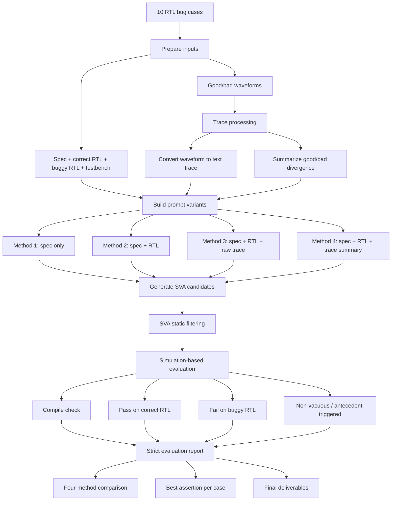

# Overall Method Flowchart

## Notes

- Each case is evaluated under the same testbench on both correct and buggy RTL.
- The four methods differ only in how much context is included in the prompt.
- Static filtering removes malformed or low-quality SVA candidates before simulation.
- Final evaluation checks syntax, correctness on the good design, bug detection on the bad design, and vacuity.
