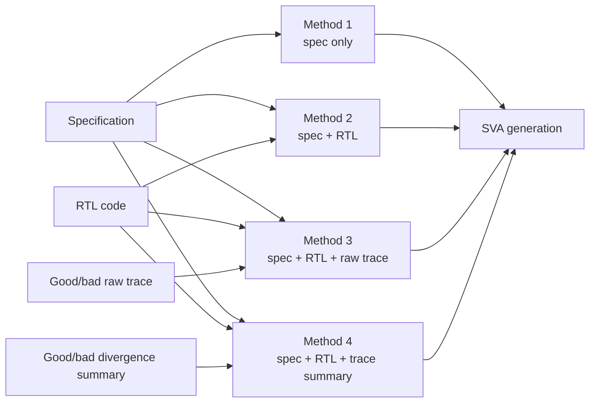

# Four Prompt Input Methods

## Input Difference

| Method | Spec | RTL | Raw Trace | Trace Summary |
|---|---:|---:|---:|---:|
| Method 1: spec only | Yes | No | No | No |
| Method 2: spec + RTL | Yes | Yes | No | No |
| Method 3: spec + RTL + raw trace | Yes | Yes | Yes | No |
| Method 4: spec + RTL + trace summary | Yes | Yes | No | Yes |

